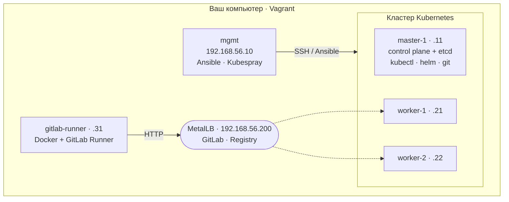

<div align="center">

# DevOps продвинутый курс
### Kubernetes и CI/CD на основе GitLab


**5 дней · онлайн · теория + живые демонстрации + практика на собственном стенде**

[Программа](#-программа-курса) · [Учебный стенд](#-учебный-стенд) · [Быстрый старт](#-быстрый-старт) · [Практика](#-практические-задания) · [Обновление материалов](#-как-получать-обновления)

</div>

---

## 🎯 О курсе

За пять дней вы пройдёте весь путь от пустых виртуальных машин до автоматического деплоя приложения в Kubernetes по `git push`:

- соберёте **кластер Kubernetes** с помощью **Kubespray** — своими руками, по шагам;
- разберётесь в архитектуре, основных сущностях и **YAML-манифестах**;
- развернёте своё **первое приложение** — с обновлением без простоя и откатом;
- освоите **Git**, развернёте **GitLab** прямо в кластере и настроите **GitLab Runner**;
- напишете **`.gitlab-ci.yml`** по best practices и упакуете приложение в **Helm-чарт**;
- свяжете **GitLab с Kubernetes**: тесты → сборка образа → деплой в staging и production.

Каждый блок устроен одинаково: **презентация с теорией и демонстрацией** → **практическое задание**, которое вы выполняете на своём стенде.

---

## 📅 Программа курса

| День | | Тема | Презентация |
|:---:|:---:|------|:---:|
| **1** | ☀️ утро | Kubernetes: основные понятия и архитектура | [PDF](day-1/01-k8s-architecture.pdf) |
| | 🌤 после обеда | Виды установок Kubernetes. Kubespray | [PDF](day-1/02-k8s-install-kubespray.pdf) |
| **2** | ☀️ утро | Kubernetes: основные сущности | [PDF](day-2/03-k8s-objects.pdf) |
| | 🌤 после обеда | Kubernetes: YAML-манифесты | [PDF](day-2/04-yaml-manifests.pdf) |
| **3** | ☀️ утро | Kubernetes: первое приложение | [PDF](day-3/05-first-app.pdf) |
| | 🌤 после обеда | Основы Git | [PDF](day-3/06-git-basics.pdf) |
| **4** | ☀️ утро | CI/CD. Обзор GitLab. Установка GitLab в Kubernetes | [PDF](day-4/07-cicd-gitlab-install.pdf) |
| | 🌤 после обеда | Ваш первый проект в GitLab | [PDF](day-4/08-first-gitlab-project.pdf) |
| | | GitLab Runner и его настройка | [PDF](day-4/09-gitlab-runner.pdf) |
| **5** | ☀️ утро | `.gitlab-ci.yml`, best practices. Helm-чарты | [PDF](day-5/10-gitlab-ci-helm.pdf) |
| | 🌤 после обеда | Интеграция GitLab с Kubernetes | [PDF](day-5/11-gitlab-k8s-integration.pdf) |

---

## 🖥 Учебный стенд

Весь стенд поднимается на вашем компьютере одной командой `vagrant up`.



| ВМ | IP | CPU | RAM | Назначение |
|----|----|:---:|:---:|-----------|
| `mgmt` | 192.168.56.10 | 1 | 1.5 GB | управляющая машина: Ansible, Kubespray |
| `master-1` | 192.168.56.11 | 2 | 2.5 GB | control plane + etcd; здесь работаем с kubectl, helm, git |
| `worker-1` | 192.168.56.21 | 2 | 4 GB | рабочий узел |
| `worker-2` | 192.168.56.22 | 2 | 4 GB | рабочий узел |
| `gitlab-runner` | 192.168.56.31 | 2 | 1.5 GB | GitLab Runner (с 4-го дня) |

ОС на всех ВМ — **Ubuntu 24.04**.

### Требования к компьютеру

- 4+ ядра CPU, **16 GB RAM** минимум (рекомендуется 32 GB), 60 GB свободного места
- **Vagrant 2.4.9+** и провайдер виртуализации под вашу ОС:

| Ваша ОС | Провайдер |
|---------|-----------|
| Windows 10/11 | VirtualBox 7.2+ |
| Linux | libvirt (рекомендуется) или VirtualBox |
| macOS Intel | VirtualBox 7.2+ |
| macOS Apple Silicon (M1–M4) | VirtualBox 7.2+ **или** qemu + socket_vmnet |

> 📌 Подробная инструкция по установке провайдера для каждой ОС и решение частых проблем — в **[vagrant/README.md](vagrant/README.md)**.
> Пожалуйста, подготовьте стенд **до начала курса**: первый запуск скачивает образ ВМ (~1 GB).

---

## 🚀 Быстрый старт

```bash
# 1. Скачать материалы курса
git clone https://github.com/samarancho/DevOps-Advanced-Cource.git
cd DevOps-Advanced-Cource/vagrant

# 2. Указать провайдер (обязательно!)
export VAGRANT_DEFAULT_PROVIDER=virtualbox      # или libvirt, или qemu
#   Windows PowerShell:  $env:VAGRANT_DEFAULT_PROVIDER = "virtualbox"

# 3. Поднять стенд
vagrant up
vagrant status

# 4. Проверить сеть между машинами — все три должны ответить OK
vagrant ssh mgmt -c 'for h in master-1 worker-1 worker-2; do ping -c1 -W1 $h >/dev/null && echo "$h OK" || echo "$h FAIL"; done'
```

Нет Git? Нажмите **Code → Download ZIP** вверху этой страницы.

---

## 📝 Практические задания

Практические задания, проверка и обратная связь — на учебной платформе **[testlms.kz](https://testlms.kz)**.

Здесь, в репозитории, — презентации и всё необходимое для стенда.

---

## 🔄 Как получать обновления

Материалы могут дополняться во время курса. Чтобы получить свежую версию:

```bash
cd DevOps-Advanced-Cource
git fetch origin
git reset --hard origin/main
```

> ⚠️ Команда заменит файлы репозитория на актуальные. Свои файлы храните **вне** этого каталога. Созданные ВМ (`vagrant/.vagrant/`) при этом не затрагиваются.

---

## 📂 Структура репозитория

```text
.
├── day-1 … day-5/              презентации дня (PDF)
└── vagrant/                    учебный стенд
    ├── Vagrantfile             описание ВМ (VirtualBox · libvirt · qemu)
    ├── README.md               установка провайдеров и частые проблемы
    ├── scripts/                первичная настройка ВМ
    ├── diag.sh                 диагностика сети стенда → diag.log
    ├── snapshot-qemu.sh        снимки ВМ для провайдера qemu
    └── io.devops-lab.socket_vmnet.plist   служба сети для qemu на macOS
```

---

<div align="center">

**Вопросы по стенду и заданиям — в разделе курса на [testlms.kz](https://testlms.kz)**

© Sairan Dyussenov · материалы предназначены для слушателей курса

</div>
